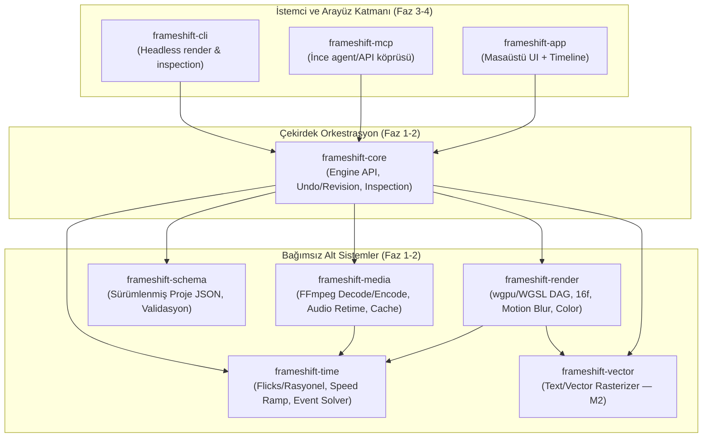
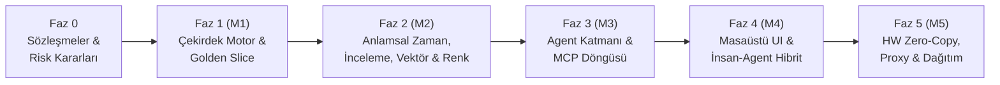

# FrameShift — Detaylı Implementasyon Planı

**Durum:** Tarihsel Faz 0–5 Ana Planı — Aşağıdaki Faz 0–5 çekirdek yol haritası (M1–M5), Faz 6.1–6.6, Anime P0, GPU `OpticalFlowBlur`/ONNX, 5 Temel Yetenek ve P1/P2/P3/P5 sütunları 9 crate'lik workspace'te (60 WGSL shader, 40 `NodeKind`, 50 CLI alt komutu, 32 MCP aracı) tamamlanmıştır; **Faz 4 / P4 etkileşimli masaüstü GUI penceresi** kullanıcı kararıyla sonraki faza bırakılmıştır. Güncel durum ve doğrulamalar için [brain/state.md](brain/state.md) dosyasına bakınız.  
**Tarih:** 2026-11-21 *(Güncel durum notu: 2026-11-24)*  
**Dayanak:** [AGENTS.md](AGENTS.md), [PROJECT_NOTES.md](PROJECT_NOTES.md), [ADR-0001](brain/decisions/0001-independent-native-gpu-core.md), [ADR-0002](brain/decisions/0002-rational-timebase-flicks.md), [ADR-0003](brain/decisions/0003-semantic-event-constraint-timing.md)

---

## 1. Stratejik Yaklaşım: Risk-First Dikey Dilim (Vertical Slice)

FrameShift'in toplam kapsamı (native GPU compositor + FFmpeg medya I/O + kesin zamanlama + anlamsal kısıtlar + metin/vektör + renk yönetimi + agent/MCP + masaüstü UI) yatay katmanlar halinde inşa edilmeye çalışılırsa entegrasyon riski projenin sonuna birikir. Bunun yerine **Risk-First Dikey Dilim** stratejisi izlenecektir:

1. **Önce Sözleşme, Sonra Kod (Faz 0 — Hibrit Hızlı Yol):** Sonradan değiştirilmesi en pahalı çekirdek sözleşmeler (`timebase.md` + ADR-0002 ve minimal `project-schema.md`) tek satır Rust yazmadan kilitlenir; render grafiği ve shader sözleşmeleri M1 prototipiyle birlikte doğrulanarak olgunlaştırılır.
2. **İlk Kilometre Taşı = "Golden Vertical Slice" (Faz 1 / M1):** UI, sohbet ekranı, MCP ve agent olmadan; yalnızca sürümlenmiş proje tanımından **hız eğrisi + hareketli maske + shader geçişi + temporal motion blur + müzik senkronu** içeren kısa bir sahne deterministik olarak render edilir.
3. **Hata İzolasyonu:** M1 geçilmeden agent katmanına geçilmez. Böylece ileride kalite düşerse sorunun *motor yetersizliği* mi yoksa *agent planlama hatası* mı olduğu kesin olarak ayrılır.
4. **Ağır Bağımlılıkları Erteleme (Pragmatik Sıralama):** Zero-copy donanım decode, tam C++ OpenColorIO FFI ve Skia/`wgpu` yüzey paylaşımı M1'i bloklamaz; M1'de temiz soyutlama trait'leri ve deterministik temel uygulamalarla çekirdek doğrulandıktan sonra kademeli eklenir.

---

## 2. Hedef Workspace ve Crate Mimarisi (Rust Monorepo)

Tüm sistem tek bir Cargo workspace içinde, sorumlulukları kesin ayrılmış crate'lerden oluşur. Edit durumu ve render mantığı UI'dan tamamen izoledir.

### Crate Sorumluluk Tablosu

| Crate | Faz | Sorumluluk Sınırı | Kritik Kural |
| :--- | :---: | :--- | :--- |
| `frameshift-time` | 1 | Flicks/rasyonel zaman, NTSC `1000/1001`, VFR PTS eşleme, hız eğrisi integrali, `event_id` kısıt çözücü | Kalıcı modelde `f64` yok; ara hesaplar izole |
| `frameshift-schema` | 1 | Sürümlenmiş proje modeli, `revision_id`, undo/redo komut günlüğü, şema doğrulama | Dışa açık sorgulanabilir JSON şeması |
| `frameshift-media` | 1 | FFmpeg kütüphane I/O (video/ses decode, seek, frame cache, ses mix/retime, encode/mux) | CLI filtre zinciri yasak; kütüphane API |
| `frameshift-render` | 1 | `wgpu` + WGSL dallanabilen render grafiği (DAG), `Rgba16Float` premultiplied-alpha, maske/matte, blend, shader geçişi, sub-frame temporal motion blur | Seek-independent; preview/final aynı semantik |
| `frameshift-vector` | 2 | Metin ve 2D vektör/şekil rasterizasyonu (`vello` vs `skia` PoC sonrası kilitlenecek) | Doğrudan GPU texture veya alfa maskesi çıktısı |
| `frameshift-core` | 1–2 | Proje oturumu, optimistic locking, render scheduler, inceleme paketi (kare/crop/maske/contact sheet) | Tüm istemcilerin tek gerçek kaynağı |
| `frameshift-cli` | 1 | Headless render, doğrulama testleri, inspection paketi ihracı | M1 kabul testi bu CLI ile koşar |
| `frameshift-mcp` | 3 | Agent için ince MCP + yerel JSON-RPC köprüsü | Motor mantığı barındırmaz |
| `frameshift-app` | 4 | Masaüstü UI (medya havuzu, timeline, viewport, özellikler, geçmiş) | Gizli UI state yasak |

---

## 3. Fazlara Bölünmüş Uygulama Yol Haritası

---

### Faz 0 — Çekirdek Sözleşmelerin Kilitlenmesi (Kod Öncesi)

**Amaç:** Koda geçildiğinde geri dönüşü pahalı olan tüm mimari sınırları `brain/specs/` altında kilitlemek.

1. **Zaman Tabanı (`brain/specs/timebase.md` + ADR-0002'nin `accepted` yapılması):**
   - `Flicks` (`i64`, `1 sn = 705,600,000`) + kare hızı `Rational32 { num, den }` (NTSC `24000/1001`, `30000/1001`, `60000/1001` tam sayı tick olarak ifade edilir; çarpımlarda `i128` ara aritmetik).
   - VFR kaynak PTS eşleme kuralı (içe aktarmada transcode yok; FFmpeg PTS indeks tablosu ile deterministik eşleme).
   - Ses örnekleme (`44.1 / 48 / 96 kHz`) ve retime sırasında ses davranışı sözleşmesi.
2. **Minimal Proje Şeması (`brain/specs/project-schema.md`):**
   - Sürümlenmiş JSON yapısı (`schema_version`, `revision_id`, `assets`, `timeline`, `events`, `graph`, `render_profiles`).
3. **Render Grafiği (`brain/specs/render-graph.md`) ve Efekt/Shader API (`brain/specs/effect-shader-api.md`):**
   - M1 prototipi ile birlikte canlı doğrulanarak kilitlenir.
   - DAG düğüm tipleri: `SourceVideo`, `SourceImage`, `Solid`, `Transform`, `MaskMatte`, `Blend`, `ShaderEffect`, `ShaderTransition`, `Precomp`, `MotionBlurShutter`.
   - Piksel formatı: Dahili çalışma yüzeyi `Rgba16Float` (premultiplied alpha); her düğümün beklediği renk alanı açık (`LinearRec709` vs `DisplaySrgb`).
   - Temporal motion blur: Shutter açısı (örn. `180°`), örnek sayısı (`N` sub-frame), shutter fazı (`centered` / `trailing`) ve ağırlıklı biriktirme formülü.
4. **Test Medyası ve Platform/Lisans Kararı:**
   - Çift katmanlı test medyası: otomatik sentetik test seti + `.gitignore` altında `local_media/` yerel gerçek anime/müzik klibi.
   - Windows (DX12/Vulkan) birincil geliştirme ortamı, LGPL dinamik FFmpeg bağlantısı.

> [!IMPORTANT]
> **Faz 0 Çıkış Kapısı (Gate 0):** `brain/specs/timebase.md` ve minimal `brain/specs/project-schema.md` kilitlenir; ADR-0002 kullanıcı tarafından `accepted` yapılır; kullanıcı ilk Cargo workspace scaffold'u için açık onay verir.

---

### Faz 1 (M1) — Çekirdek Motor ve "Golden Vertical Slice"

**Amaç:** UI ve agent olmadan, doğrudan proje JSON'undan Golden Scene'i (hız eğrisi + hareketli maske + shader geçişi + temporal motion blur + müzik) deterministik olarak MP4'e render etmek.

#### Adım 1.1 — `frameshift-time` ve `frameshift-schema`
- `Tick(i64)` (Flicks) ve `Rational` tipleri, taşma korumalı (`i128`) dönüşümler.
- **Hız Eğrisi (Speed Ramp) Motoru:** Parçalı Bézier / Hermite hız eğrisinin sayısal integrali ile `output_tick -> source_tick` deterministik eşlemesi (ileri, yavaşlama, hızlanma, freeze ve reverse desteği).
- Sürümlenmiş proje JSON okuma/yazma, şema doğrulama ve temel komut tabanlı undo/redo iskeleti.
- **Testler:** `23.976 / 29.97 / 60 fps` ile `44.1 / 48 kHz` ses sınırlarında 10 saatlik zaman çizgisinde sıfır drift property testleri.

#### Adım 1.2 — `frameshift-media` (Temel Kütüphane Hattı)
- FFmpeg C kütüphanelerine (`libavformat`, `libavcodec`, `libswscale`, `libswresample`) ince, güvenli Rust sarmalayıcı (M1'de güvenilir ve deterministik yazılım decode + async staging buffer ile GPU upload; donanım zero-copy Faz 5'te).
- **Seek-Independent Frame Decoder:** Belirli bir `source_tick` istendiğinde VFR/CFR PTS indeksinden GOP anahtar karesine seek edip doğru kareyi döndüren, LRU önbellekli decoder.
- **Ses Hattı:** Kaynak müzik + klip sesini `48 kHz f32` ortak ara formatta miksleyip çıktıya mux etme.
- **Encode:** `wgpu` çıktı dokusundan (RGBA16F -> tonemap/display -> RGBA8/YUV420P) H.264/HEVC MP4 encode.

#### Adım 1.3 — `frameshift-render` (Unified `wgpu` + WGSL Compositor)
- Headless `wgpu::Device` başlatma (DX12 / Vulkan / Metal).
- Render grafiği topolojik sıralama + ara doku havuzu (`TexturePool`, `Rgba16Float` bellek yeniden kullanımı).
- Çekirdek yerleşik WGSL düğümleri:
  - `Transform` (konum, ölçek, dönüş, anchor, bicubic/bilinear örnekleme),
  - `MaskMatte` (hareketli alfa/luma maske + kenar yumuşatma),
  - `Blend` (Normal, Add, Screen, Multiply, Overlay — premultiplied alpha uyumlu),
  - `ColorBasic` (`ColorTransform` trait'i arkasında sRGB ↔ Linear Rec.709, exposure, glow/bloom threshold + Kawase blur),
  - `ShaderTransition` (iki klip girişli özel WGSL geçişi; örn. directional zoom/whip + chromatic aberration).
- **Sub-Frame Temporal Motion Blur:** Çıktı karesi `t` için shutter aralığında (`[t - Δ, t + Δ]`) `N` alt-zamanda (örn. 8–16 örnek) tüm grafiği (transform + maske + geçiş + hız eğrisi dahil) değerlendirip `Rgba16Float` akümülatörde toplama.

#### Adım 1.4 — `frameshift-cli` ve Golden Scene Kabul Testi
- `frameshift render project.json --out out.mp4 --profile draft|final`
- `frameshift frame project.json --tick <T> --out frame.png`
- **M1 Çıkış Kapısı (Gate 1):**
  1. Golden Scene (hız eğrisi + hareketli maske + shader geçişi + temporal motion blur + müzik) baştan sona render edilir.
  2. **Determinizm Testi:** Aynı proje iki kez render edildiğinde kare hash'leri birebir eşleşir.
  3. **Seek-Independence Testi:** Rastgele tek kare render'ı (`--tick T`) ile sıralı video render'ındaki `T` anı karesi piksel düzeyinde eşleşir.
  4. **Ses Senkronu:** Bilinen beat/click test tonu ile görsel flash/impact karesi 1 kare içinde hizalıdır.

---

### Faz 2 (M2) — Anlamsal Zamanlama, İnceleme Yüzeyleri, Metin/Vektör ve Renk

**Amaç:** Motoru "sadece render alan bir araç"tan çıkarıp agent'ın güvenle yönetebileceği, inceleyebileceği ve AMV/motion graphics üretebileceği bir çekirdeğe dönüştürmek.

1. **Olay ve Kısıt Tabanlı Zamanlama (ADR-0003):**
   - `event_id` veri modeli (kaynak impact işareti ↔ hedef müzik beat/drop zamanı).
   - **Impact Hizalama Çözücüsü:** Verilen kaynak aralığı, çıktı aralığı ve hız sınırları (`min_speed`, `max_speed`) içinde, hedef çıktı anında kaynak-zaman eğrisini tam impact işaretine oturtan deterministik çözücü.
   - **Sessiz Bozulma Yasağı:** Çözüm imkânsızsa ihlal edilen kısıtları ve somut çözüm seçeneklerini yapılandırılmış hata olarak döndürme.
   - `event_id` ofsetine bağlı animasyonlar (glow, flash, shake, yazı) olay taşındığında otomatik yeniden hesaplanır; kaynak maske/tracking verisi kaynak zamanına bağlı kalır.
2. **Çoklu İnceleme Paketi Üreticisi (`inspection-contract.md`):**
   - Tüm çıktılar ortak `revision_id` + `tick` kimliği taşır.
   - Tek kare, tam çözünürlüklü crop, maske paketi (kaynak + maske + dama zemin + final), geçiş paketi (A + B + birleşik), velocity paketi ve okunabilir etiketli **contact sheet** üretimi.
   - Kısa sesli taslak klip render'ı + teknik rapor (kaynak-zaman haritası, uyarılar, kalite profili).
3. **Text / Vector Entegrasyonu (`frameshift-vector`):**
   - Kısa PoC karşılaştırması: **`vello` (Rust-native, doğrudan `wgpu` compute)** vs **`skia-safe`**.
   - Seçilen motorla tipografi, animasyonlu metin ve vektör maske/şekil düğümlerinin `Rgba16Float` grafiğine bağlanması.
4. **Renk Yönetimi ve Güvenli Expression:**
   - OpenColorIO entegrasyonu (veya 3D LUT + OCIO config desteği) ile giriş/çalışma/çıktı renk hattının tamamlanması.
   - Parametre bağlama için sınırlandırılmış (fuel-limited, döngüsüz) expression değerlendirici (örn. ses enerjisine veya `event_id` mesafesine bağlı shake/glow).
5. **Ses Analizi ve Retime:**
   - Beat, onset ve RMS enerji zarfı çıkarma (algoritmik teknik belirti katmanı).
   - Retime sırasında ses işleme (varispeed / pitch-preserving seçenekleri açık sözleşmeyle).

> [!NOTE]
> **Faz 2 Çıkış Kapısı (Gate 2):** Impact zamanı kaydırıldığında bağlı hız eğrisi ve glow/shake efektleri otomatik güncellenir; geçersiz kısıt sessizce bozulmadan reddedilir; inceleme paketi aynı `revision_id` ile eksiksiz üretilir.

---

### Faz 3 (M3) — Agent Katmanı, MCP ve Yaratıcı Yönetmenlik Döngüsü

**Amaç:** Çalışan çekirdeği agent'ların doğrudan, şema-güdümlü ve güvenli şekilde kullanabilmesini sağlamak.

1. **`frameshift-mcp` (İnce Bağlantı Katmanı):**
   - Sorgulanabilir API ve düğüm şeması (`describe_schema`, `list_nodes`).
   - Optimistic locking (`expected_revision_id`) ile proje mutasyonları, atomik işlem grupları ve rollback/undo.
   - Görsel inceleme paketlerini (contact sheet, crop, maske) modele gerçek görüntü payload'ı olarak ileten adaptör.
2. **Tembel Yüklemeli Teknik Skill Aileleri:**
   - Yalnızca motorda **gerçekten çalışan** yetenekler için: ritim/kurgu, velocity/time-remap, maske/kompozisyon, shader geçişleri, tipografi ve kalite kontrol rehberleri.
   - Teknik tarif (nasıl yapılır) ile yaratıcı stil (ne zaman/neden yapılır) ayrımı.
3. **Yaratıcı Karar ve Tercih Kaydı:**
   - Proje içi yapılandırılmış yaratıcı karar günlüğü (yaklaşım, gerekçe, korunacak özellikler, riskler).
   - 3 seviyeli kullanıcı tercih kaydı (genel / proje / tek sahne) — açık düzenlenebilir JSON/YAML.
4. **M3 Çıkış Kapısı (Gate 3):**
   - M1'deki Golden Scene benzeri bir edit, bu kez yalnızca kullanıcı brief'i + klip + müzik verilerek agent tarafından üretilir, inceleme döngüsüyle revize edilir ve insan gözüyle doğrulanır.

---

### Faz 4 (M4) — Masaüstü UI ve Hibrit İnsan-Agent Çalışma Alanı

**Amaç:** Kullanıcının agent işlemlerini canlı izlemesi ve gerektiğinde timeline/özellikler üzerinden doğrudan müdahale edebilmesi.

1. **UI Teknoloji Kararı (Faz 4 Başında Kilitlenir):**
   - **Onaylanan Yönelim: Rust-Native (`egui` / `iced` / `gpui`)** — `wgpu` önizleme viewport'u ile sıfır kopya doğrudan GPU yüzey paylaşımı, tek ikili dosya, düşük bellek.
2. **Temel UI Modülleri (Hepsi `frameshift-core` Tüketicisi):**
   - Medya kütüphanesi, çok katmanlı timeline (`event_id` ve beat işaretçileri görünür), canlı `wgpu` önizleme viewport'u, seçili öğe özellik paneli, işlem geçmişi (undo/redo) ve agent aktivite akışı.
3. **Eşzamanlılık ve Yaşam Döngüsü:**
   - Kullanıcı timeline'da sürükleme yaparken agent'ın eski `revision_id` ile ezmesini önleyen çakışma koruması.
   - Pencere kapandığında devam eden render/agent işleri için arka plan daemon/worker yaşam döngüsü kararı.

---

### Faz 5 (M5) — Performans, Donanım Hızlandırma ve Dağıtım

1. **Zero-Copy Donanım Hattı:** Platforma özel hardware decode → `wgpu` external texture → hardware encode (Windows D3D11VA/NVDEC, macOS VideoToolbox, Linux VAAPI) — deterministik yazılım yolu fallback olarak korunur.
2. **Proxy Sistemi:** Hızlı önizleme için otomatik proxy üretimi; proxy/final zamanlama ve maske semantiği eşdeğerlik testleriyle doğrulanır.
3. **Paketleme ve Lisans Denetimi:** FFmpeg LGPL uyumluluğu, dinamik kütüphane dağıtımı, FrameShift marka/paket adı kontrolü ve cross-platform CI/CD.

---

## 4. Kritik Mühendislik Riskleri ve Kör Nokta Azaltma Matrisi

| Risk / Kör Nokta | Neden Kritik? | Azaltma Stratejisi |
| :--- | :--- | :--- |
| **FFmpeg Windows/MSVC Build & Lisans** | Rust FFmpeg binding'leri (`ffmpeg-next`/`rsmpeg`) Windows'ta clang/vcpkg/bindgen sürtünmesi çıkarır; yanlış build GPL'i tetikler. | Faz 0'da LGPL dinamik FFmpeg build sözleşmesi sabitlenir; Faz 1'de tekrarlanabilir build script'i ve ince FFI katmanı kurulur. |
| **Skia + `wgpu` Entegrasyon Ağırlığı** | `skia-safe` derlemesi ağırdır ve `wgpu` ile doğrudan GPU yüzey paylaşımı kırılgan olabilir. | M1'de metin/vektör zorunlu tutulmaz; M2 başında **`vello` (saf Rust + `wgpu` compute)** ile `skia-safe` küçük bir PoC ile kıyaslanır. |
| **OpenColorIO C++ FFI Sürtünmesi** | OCIO büyük bir C++ kütüphanesidir; M1 hızını yavaşlatabilir. | M1'de renk hattı `ColorTransform` trait'i arkasında WGSL (`sRGB <-> Linear Rec.709`) ile kurulur; tam OCIO C++ / 3D LUT desteği M2'de takılır. |
| **WGSL Sonsuz Döngü (GPU TDR)** | Kullanıcı/agent üretimi özel shader'lar GPU sürücüsünü kilitleyebilir (Windows TDR ~2 sn). | `naga` ile statik doğrulama, döngü/komut üst sınırı (loop bound) ve render worker timeout/recovery mekanizması. |
| **VFR Medya ve Ses Retime Drift'i** | Ekran kaydı/telefon/bazı anime kaynakları VFR'dır; naive frame-index hesabı senkronu bozar. | İçe aktarmada tüm kaynaklar için PTS indeks tablosu çıkarılır; `source_tick -> nearest_pts` deterministik eşlenir. |
| **Önizleme / Final Ayrışması** | Düşük çözünürlüklü önizlemede piksel tabanlı blur/shake değerleri değişebilir. | Tüm uzamsal parametreler piksel yerine normalize/referans çözünürlüğe göre tanımlanır; preview/final fark testi CI'da koşar. |

---

## 5. Onaylanan Tasarım Kararları (`/grill-me` Özeti)

Aşağıdaki 6 tasarım kararı kullanıcı ile adım adım netleştirilerek onaylanmıştır:

| # | Tasarım Dalı | Onaylanan Karar |
| :-: | :--- | :--- |
| 1 | **Başlangıç Stratejisi** | **Hibrit Hızlı Yol:** Önce `timebase.md` (+ ADR-0002) ve minimal `project-schema.md` kilitlenir; ardından M1 prototipine (Cargo workspace + Golden Slice) geçilir. |
| 2 | **Zaman Tabanı & VFR** | **Flicks (`i64`, `705,600,000/sn`) + Rational FPS + VFR PTS İndeksleme** (içe aktarmada transcode yok, çarpımlarda `i128`). |
| 3 | **Platform & M1 Medya Hattı** | **Windows birincil (DX12/Vulkan)** + LGPL dinamik FFmpeg FFI + M1'de deterministik yazılım decode → GPU upload (donanım zero-copy Faz 5'te). |
| 4 | **Renk & Text/Vector** | M1'de `ColorTransform` trait'i + WGSL temel renk dönüşümü + alfa maske; M2'de tam **OpenColorIO** ve **`vello` vs `skia`** PoC ile seçim. |
| 5 | **M1 Test Medyası** | **Çift Katmanlı:** Otomatik sentetik test seti (0-drift / seek / senkron) + `.gitignore` altında `local_media/` yerel gerçek anime/müzik klibi. |
| 6 | **Masaüstü UI Yönü** | **Rust-Native UI yönelimi** (`egui`/`iced`/`gpui` — kesin seçim Faz 4 başında) + doğrudan `wgpu` viewport paylaşımı. |

### Hemen Sıradaki Adım (Faz 0 — Hibrit Hızlı Yol)

1. `brain/specs/timebase.md` dosyasını yazıp [ADR-0002](brain/decisions/0002-rational-timebase-flicks.md) kararını kullanıcı onayıyla `accepted` durumuna getirmek.
2. `brain/specs/project-schema.md` minimal M1 şemasını yazıp kilitlemek.
3. Kullanıcı onayıyla ilk Cargo workspace scaffold'unu başlatıp M1 (`frameshift-time` → `frameshift-schema` → `frameshift-media` → `frameshift-render` → `frameshift-cli`) inşa etmek.
